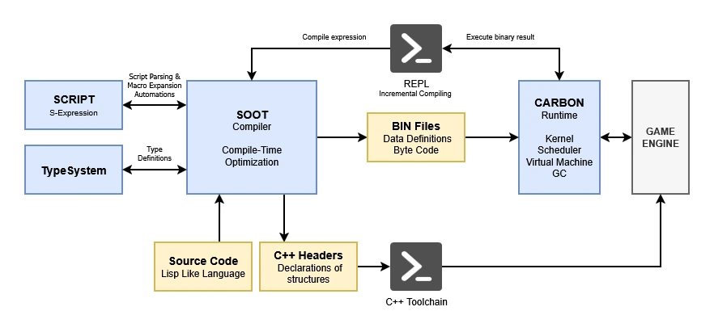

# SOOT: Scriptable Object-Oriented Toolkit


## SOOT & Carbon: A Tiered Ecosystem for Embedded Automation

**SOOT** is an embeddable Lisp interpreter, inherited from **GOOS** and
engineered with modern C++, designed to orchestrate automation toolkits
for constrained hardware (CPUs, MCUs, DSPs). It serves as the high-level
control centre, bridging the gap between raw source code and final
deployment.

### The Architecture: SOOT and Carbon

The system is divided into two distinct layers to separate high-level
logic from low-level execution:



* **SOOT (the orchestrator):** a flexible Lisp interpreter used to
  design scripts for compiling and linking entire projects. Beyond
  simple builds, SOOT acts as a preprocessor, capable of modifying
  source files on the fly. Its integrated **REPL** lets developers
  inspect and debug every stage of the pipeline — from code
  transformation to target communication — in an iterative loop.

* **Carbon (the execution layer):** a specialised environment
  consisting of its own virtual machine and compiler. Carbon is the
  foundation for execution; the SOOT interpreter remains independent,
  acting as the manager that directs the compiler's operations.

> **Note:** the Carbon VM is fully functional. The Carbon compiler is
> under active development.


### Design Goals

* **Zero-dependency core:** minimal external requirements.
* **Memory efficiency:** tailored for MCUs and DSPs.
* **Developer-centric:** built-in REPL for rapid hardware prototyping.

### Integrated Workflow

SOOT provides a unified interface for the entire development lifecycle:

1. **Preprocessing:** dynamic modification of source code via Lisp scripts.
2. **Orchestration:** managing the compilation and linking process for the target platform.
3. **Automation:** handling firmware upload and establishing a communication link with the hardware.
4. **Inspection:** using the REPL at any stage for real-time debugging and system analysis.

---

## ✨ Key Features

| Feature                | Description                                                                          |
|------------------------|--------------------------------------------------------------------------------------|
| **Orchestration core** | Lisp interpreter for build automation, linking, and source preprocessing.            |
| **Carbon VM**          | A high-performance FunctionDesc execution engine for target platforms, managed by SOOT. |
| **Interactive REPL**   | Full-featured environment for real-time debugging of the entire pipeline.            |
| **Hybrid execution**   | Supports Lisp sources and the upcoming compiled FunctionDesc (`.bin`).                |
| **Embedded & remote**  | Minimal footprint for integration with an nREPL server for remote hardware links.    |
| **Modern tooling**     | XDG compliance, syntax highlighting, multiline editing, and command history.         |
| **Carbon compiler**    | **(in development)** native toolchain to bridge SOOT logic with Carbon VM execution. |

---

## 🚀 Quick Start

### Build & install

```bash
git clone https://github.com/hww/soot.git
cd soot

mkdir build && cd build
cmake .. -DCMAKE_BUILD_TYPE=Release -DCMAKE_INSTALL_PREFIX=/usr/local
cmake --build . -j

sudo cmake --install .

# verify
sootc --version
carbon --version
```

Platform-specific notes:

- [Windows](./docs/setup/system/windows.md)
- [Linux](./docs/setup/system/linux.md)
- [macOS](./docs/setup/system/macos.md)

---

## 📚 Usage

The tree contains two command-line tools:

* **`sootc`** — the compiler and REPL front-end.
* **`carbon`** — the runtime host (loads `.bin` modules, runs the tick
  loop, serves the wire protocol).

Both tools read the same `soot.json`, so a single project file drives
the whole pipeline.

### `sootc` — the compiler

```text
Usage: sootc [options] [file...]
```

Common options (both tools):

| Option              | Description                                                    |
|---------------------|----------------------------------------------------------------|
| `--project-root <dir>` | Project root. All relative module paths resolve against it. |
| `--config <file>`   | Read this file instead of searching for `soot.json`.           |
| `--no-config`       | Do not read `soot.json` at all.                                |
| `--sidbase <file>`  | String-ID table: load before, save after.                      |
| `--log <level>`     | `trace` \| `debug` \| `info` \| `warn` \| `error`.             |
| `-q` / `-v` / `-vv` | Less / more log output (sugar over `--log`).                   |
| `--log-file <file>` | Additional log destination. stderr is always on.               |
| `--color <when>`    | `auto` \| `always` \| `never`.                                 |
| `-I <dir>`          | Add a module search path (repeatable).                         |
| `-h`, `--help`      | Show help.                                                     |
| `-V`, `--version`   | Show version.                                                  |

Compiler-only options:

| Option              | Description                                                    |
|---------------------|----------------------------------------------------------------|
| `--mode <m>`        | `compile` \| `interpret` \| `hybrid` (default: `hybrid`).      |
| `--dump <list>`     | Comma-separated: `ast`, `ir`, `asm`, `listing`.                |
| `--out-dir <dir>`   | Output directory for `.bin` / `.h` (default: `build`).         |
| `--profile <name>`  | Load a user profile at startup.                                |
| `--runtime <url>`   | `local` \| `null` \| `host:port`.                              |
| `--[no-]repl`       | Open the REPL after compiling (overrides `soot.json`).         |
| `--do <file>`       | Execute a script in the compiler session (repeatable).         |
| `--run <file>`      | Alias for `--do`.                                              |

Examples:

```bash
# Compile a file, do not open the REPL
sootc --no-repl hello.sc

# Compile, then open the REPL
sootc hello.sc

# Compile with a dump of the AST
sootc --dump ast hello.sc

# Run a do-script, then exit (no input files, no REPL)
sootc --do build.do
```

### `carbon` — the runtime

```text
Usage: carbon [options] [file.bin] [function] [args...]
```

Common options — same as `sootc` (see table above).

Host-only options:

| Option              | Description                                                    |
|---------------------|----------------------------------------------------------------|
| `--listen <addr>`   | Address to listen on, `host:port` (default: `127.0.0.1:8181`).  |
| `--[no-]serve`      | Run the HTTP/REPL host loop.                                   |
| `--hz <n>`          | Tick rate in Hz (default: 60).                                 |
| `--ticks <n>`       | Stop after N ticks (default: unlimited, `-1`).                 |
| `--run <name>`      | Spawn a state-script and run the tick loop.                    |
| `-l, --load <file>` | Load a `.bin` module explicitly (repeatable).                  |

Examples:

```bash
# Call a function once and exit
carbon program.bin main 42

# Load two modules, then call a function
carbon -l a.bin -l b.bin main

# Spawn a state-script and run the tick loop
carbon --run worker --hz 60

# Serve the wire protocol
carbon --serve --listen 127.0.0.1:8181
```

### Choosing an option

The same option name means different things in the two tools only where
the semantics genuinely differ:

* `sootc --run <file>` — a do-script (alias for `--do`).
* `carbon --run <name>` — a state-script name to spawn.

Everything else — `--project-root`, `--config`, `--sidbase`, `--log`,
`-I`, `--color` — is shared.

Passing an option to the wrong tool is an error, not a silent no-op:

```text
$ carbon --mode hybrid
error: --mode is a sootc option, not a carbon option
```

---

## ⚙️ Configuration

### The single project file

`soot.json` lives at the project root and is the single source of truth
for both tools. It has three sections:

```json
{
  "common": {
    "project-root": ".",
    "sidbase": "build/sidbase.bin",
    "log": "warn",
    "search-paths": [".", "scripts", "src", "examples", "soot_src"]
  },
  "compiler": {
    "mode": "hybrid",
    "out-dir": "build",
    "repl": false,
    "runtime": "local",
    "do": []
  },
  "host": {
    "listen": "127.0.0.1:8181",
    "serve": false,
    "hz": 60,
    "ticks": -1
  }
}
```

Missing keys keep their defaults. Unknown keys inside `common`,
`compiler`, or `host` produce a warning. Keys at the top level (outside
those sections) are an error: the legacy flat layout is no longer
supported.

### Priority

```text
CLI > environment > soot.json > defaults
```

Each layer only writes the keys it has. `--config <file>` reads a
different file; `--no-config` skips `soot.json` entirely.

### Environment variables

| Variable            | Corresponds to                     |
|---------------------|------------------------------------|
| `SOOT_PROJECT_ROOT` | `common.project-root`              |
| `SOOT_SIDBASE`      | `common.sidbase`                   |
| `SOOT_LOG`          | `common.log`                       |
| `SOOT_LOG_FILE`     | `common.log-file`                  |
| `SOOT_COLOR`        | `common.color`                     |
| `SOOT_MODE`         | `compiler.mode`                    |
| `SOOT_RUNTIME`      | `compiler.runtime`                 |
| `SOOT_OUT_DIR`      | `compiler.out-dir`                 |

### REPL

Inside `sootc`'s REPL, the compiler's current options can be inspected
and changed:

```text
(opt)                   list every option and its current value
(opt "log")             print one option
(opt "log" "debug")     change one option in memory
```

Changes apply to the running session only; the file on disk is not
touched. To persist a value, edit `soot.json` directly.

---

## 📁 Configuration paths

Both tools resolve paths the same way:

| Path type   | Resolution logic                              |
|-------------|-----------------------------------------------|
| **CWD**     | `fs::current_path()`                          |
| **EXE**     | executable's directory                        |
| **HOME**    | `$HOME` or current path fallback              |
| **CONFIG**  | `$XDG_CONFIG_HOME/soot/` or `~/.config/soot/` |
| **CACHE**   | `$XDG_CACHE_HOME/soot/` or `~/.cache/soot/`   |
| **SHARE**   | `/usr/local/share/soot/`                      |
| **PROJECT** | `soot.json`'s directory, or `--project-root`  |

Search order for `find_config_file()`:

1. Project: `PROJECT/filename`
2. User:    `CONFIG/filename`
3. System:  `SHARE/filename`

---

## 🤝 Contributing

See [CONTRIBUTING.md](CONTRIBUTING.md).

### Development workflow

```bash
git clone https://github.com/hww/soot.git
cd soot
git checkout -b feature/amazing-feature

cmake -B build -DCMAKE_BUILD_TYPE=Debug
cmake --build build -j
ctest --test-dir build

git commit -am "Add amazing feature"
git push origin feature/amazing-feature
```

## 🎨 Emacs configuration

```lisp
(add-to-list 'auto-mode-alist '("\\.sc\\'" . lisp-mode))
(add-to-list 'auto-mode-alist '("\\.st\\'" . lisp-mode))
(add-hook 'lisp-mode-hook 'setup-soot)

(defun setup-soot ()
  (when (and (stringp buffer-file-name)
             (string-match "\\.sc\\'" buffer-file-name))
    (put 'with-pp      'common-lisp-indent-function 0)
    (put 'while        'common-lisp-indent-function 1)
    (put 'rlet         'common-lisp-indent-function 1)
    (put 'until        'common-lisp-indent-function 1)
    (put 'countdown    'common-lisp-indent-function 1)
    (put 'defun-debug  'common-lisp-indent-function 2)
    (put 'defenum      'common-lisp-indent-function 2)

    (custom-set-variables '(lisp-indent-function 'common-lisp-indent-function))
    (autoload 'common-lisp-indent-function "cl-indent" "Common Lisp indent.")
    (setq-default indent-tabs-mode nil)))
```

## 🎯 Code style

* Follow the [Google C++ Style Guide](https://google.github.io/styleguide/cppguide.html).
* Use `clang-format`.
* Document public APIs with Doxygen-style comments.

---

## 📖 Other documentation

* [SOOT script language — quick reference](common/script/README.md)
* [SOOT common library](common/script/README.LIB.md)

---

## 📄 License

MIT. See [LICENSE](LICENSE).

---

⭐ **Star this repo if you find SOOT useful!** ⭐
```

